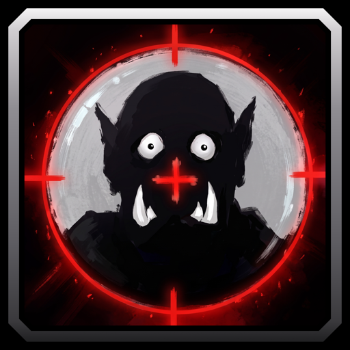

# Target Finder

A WoW Forever addon that gives you one FIND button to target, raid-mark and ping the NPCs your quests need, plus any NPC or player you add. Quest NPCs come from QuestieDB, Questie's quest database, which the CurseForge app installs with Target Finder. Questie itself is not needed.

## Features

- FIND drops a dead target, then targets the first name on your list that is in range.
- Target Finder creates the FIND macro for you and keeps it up to date.
- Track and Untrack sit at the top of the right-click menu on NPC and player portraits.
- Apply Raid Markers: FIND marks the NPC it targets with a cross, as RestedXP's macro does.
- Apply Pings: FIND also pings the NPC it targets as your ping key does, so your group sees it. Off until you tick it.
- Up to eight names, with row 1 first. Drag a row's number to change the order. Names you add are never replaced.
- Auto Apply Quest NPCs fills free rows with the nearby NPCs you need to kill, loot or talk to. They update when you accept, turn in or abandon a quest and when you change zones.
- Quest and NPC names are suggested as you type.

## Usage

1. Type `/tf` or click the minimap button.
2. Add a name: type it in a row, right-click a portrait and pick Track, or type `/tf add` with your target selected.
3. Target Finder creates your FIND macro and opens the macro book on it. Drag the glowing icon to an action bar, or drag the icon in the window's top-left corner.
4. Press FIND to target the first name in range.
5. Right-click the minimap button or type `/tf refresh` to update the quest NPCs where you stand.
6. Untick Auto Apply Quest NPCs to keep only the names you add, or Apply Raid Markers to target without marking. Tick Apply Pings to ping each target too.

Commands: `/tf`, `/tf add`, `/tf refresh`, `/tf minimap`, `/tf intro` and `/tf help`.

FIND needs a free character macro slot. In a group, markers need leader or assistant rights.
