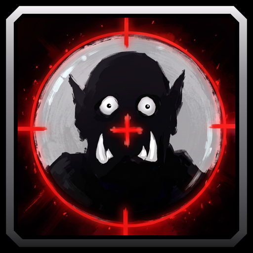

# Target Finder

One FIND button targets, raid-marks and pings the quest mobs and NPCs you need, using Questie's data without Questie.

- **Fills** your list with the quest NPCs near you
- **Targets** the first living one in range with one press
- **Marks** and pings it for your group

## Why use it

- **Questie's data, no Questie.** Quest NPCs come from QuestieDB, Questie's quest database, which the CurseForge app installs with it.
- **Like RestedXP's targeting macro.** One button for every quest, plus any NPC or player you add.
- **Hands-free list.** Quest NPCs come and go as you move and finish objectives.

## Features

- FIND targets the first living name in range. A name it can't find, or finds only dead, hands over to the next row
- Target Finder creates the FIND macro and keeps it up to date
- Up to eight names, row 1 first. Drag a row by its left end to reorder. Names you add are never replaced
- Auto Apply Quest NPCs fills free rows with the NPCs within 60 yards you need to kill, loot or talk to. They leave when you finish an objective or turn in, abandon or accept a quest
- Find Target and Untrack at the top of NPC and player portrait right-click menus
- Apply Raid Markers marks each target with a cross
- Apply Pings pings each target as your ping key does, so your group sees it. Off until you tick it
- Exact Names matches whole names only. Untick it to let Murloc match Murloc Forager
- Quest and NPC names are suggested as you type

## Quick start

1. Type `/tf` or click the minimap button
2. Add a name: type it in a row, right-click a portrait and pick Find Target, or type `/tf add` with a target selected
3. Target Finder opens the macro book on FIND. Drag its glowing icon to an action bar, or drag the icon in the window's top-left corner
4. Press **FIND**
5. Right-click the minimap button or type `/tf refresh` to update the quest NPCs where you stand

## Commands

`/tf`, `/tf add`, `/tf refresh`, `/tf minimap`, `/tf intro` and `/tf help`

## Good to know

- FIND is a General macro your characters share, so it needs a free General slot
- A macro holds 255 characters, so with long names the lowest rows may not fit
- In a group, markers need leader or assistant rights

## Requirements

- QuestieDB, which the CurseForge app installs with it. Questie itself is not needed
